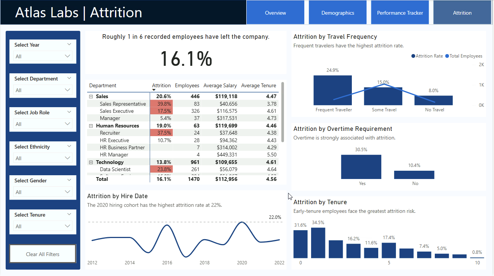
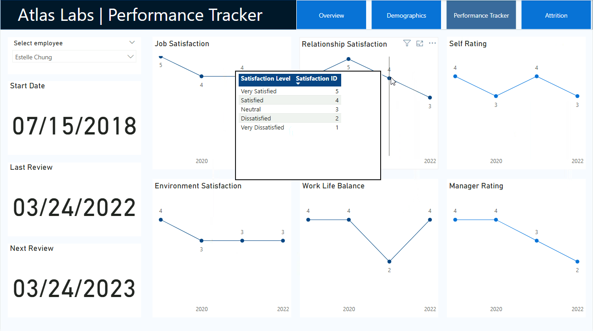
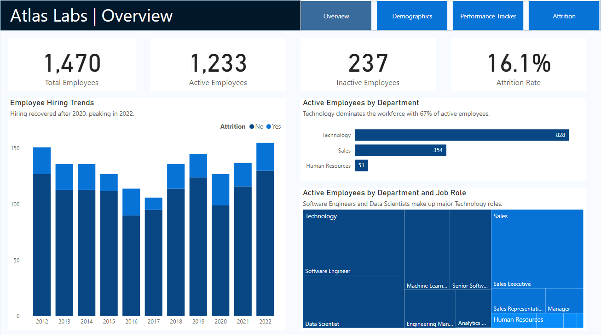
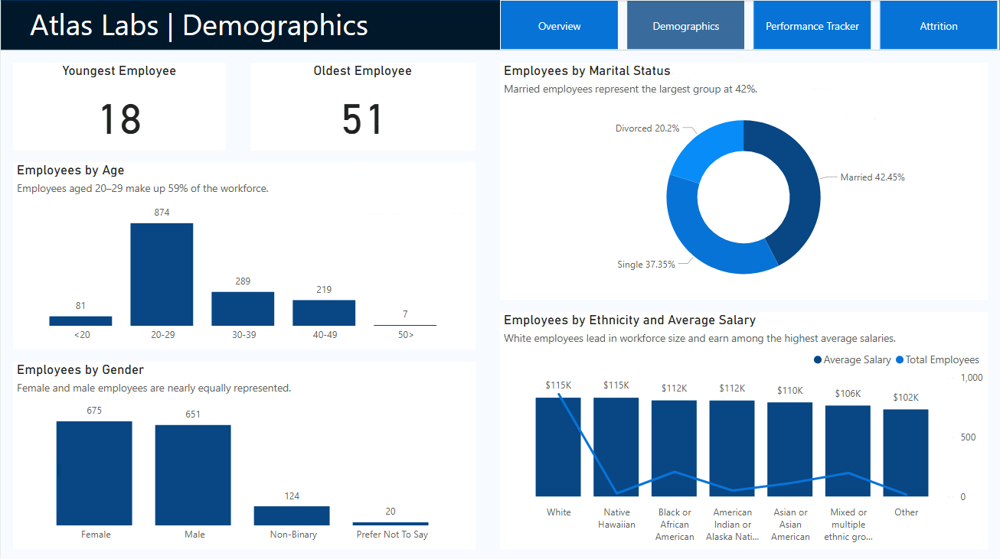
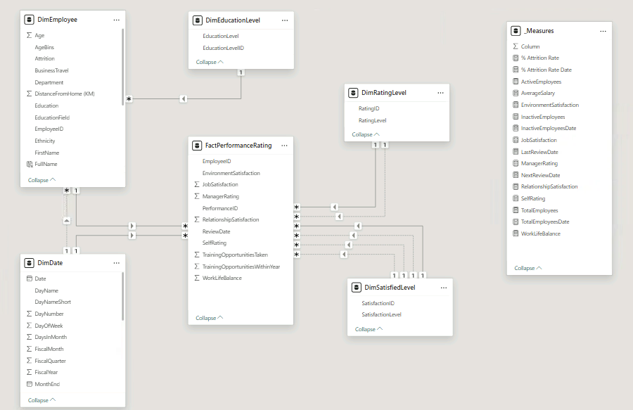

# HR Analytics & Employee Attrition Analysis

## The Decision

**Where should Atlas Labs prioritize employee retention efforts to reduce turnover and maintain workforce stability?**

The organization has an overall employee attrition rate of **16.1%**, with higher turnover in certain job roles and among employees working overtime or traveling frequently. Early employee turnover also increases replacement and onboarding costs while disrupting productivity.

This analysis explores workforce demographics, performance, and attrition patterns to identify high-risk groups and help HR leadership develop targeted, evidence-based retention strategies.

## What the Business Needs to Know

| Total Employees | Active Employees | Attrition Rate | Highest-Risk Job Role |
|---|---|---|---|
| **1,470** | **1,233** | **16.1%** | **39.8% Sales Representatives** |

Employee turnover is concentrated in specific workforce segments rather than distributed evenly across the organization.

- Employees required to work overtime have a **30.5% attrition rate**, nearly three times the **10.4%** rate among those without overtime. 

- Frequent travelers also experience higher attrition (**24.9% vs. 8.0%** for non-travelers).

- Early-tenure employees face the greatest attrition risk.

These findings suggest that HR should prioritize reviewing overtime expectations, travel demands, early-tenure employee support, and retention challenges within high-turnover job roles.

## Recommended Actions

### 1. Reduce overtime-related attrition

Employees required to work overtime have a **30.5% attrition rate**, compared with **10.4%** among employees without overtime requirements.

This gap suggests that workload expectations may be an important retention risk worth investigating.

**Recommended action:** Identify departments and job roles with high overtime requirements. Review workload distribution, staffing capacity, and scheduling practices, then pilot workload adjustments in high-risk teams.

**Measure success:** Track attrition rates, overtime hours, and employee satisfaction before and after the intervention to assess whether retention improves.

### 2. Review business travel expectations

Employees who travel frequently experience a **24.9% attrition rate**, compared with **8.0%** among employees who do not travel.

This substantial difference suggests that frequent business travel may be associated with retention challenges, potentially related to scheduling demands or work-life balance.

**Recommended action:** Review travel requirements for high-travel roles and explore alternatives such as virtual meetings, flexible scheduling, and recovery time after extended business trips.

**Measure success:** Compare attrition rates, travel frequency, and work-life balance satisfaction over time to evaluate the effectiveness of these changes.

### 3. Strengthen retention during the first two years

Employees with **one year of tenure have the highest attrition rate at 34.5%**, followed by employees with less than one year at **31.6%**.

The Performance Tracker allows managers to use an employee slicer to monitor individual performance and satisfaction trends, helping spot potential issues early.

**Recommended action:** Strengthen onboarding and introduce structured check-ins at 30, 90, and 180 days. Pair new hires with mentors and collect feedback to identify unmet expectations or workplace challenges before employees decide to leave.

**Measure success:** Monitor first-year attrition, employee satisfaction, and retention at 6 and 12 months.

### 4. Prioritize retention in high-turnover job roles

**Sales Representatives have the highest attrition rate at 39.8%**, followed by Recruiters at **37.5%** and Data Scientists at **23.8%**.

These differences suggest that retention challenges may vary significantly by job role, requiring more targeted strategies rather than a company-wide approach. The Workforce Overview provides additional context on department and job-role headcount, helping HR consider workforce size alongside attrition rates.

**Recommended action:** Conduct targeted employee surveys and exit interviews to investigate compensation, workload, management support, and career advancement opportunities. Prioritize interventions using both attrition rates and the number of employees affected.

**Measure success:** Track job-role attrition, employee satisfaction, and retention trends to evaluate whether targeted interventions reduce turnover.

### 5. Strengthen workforce development and compensation equity

**Employees aged 20–29 represent nearly 60% of the workforce**, emphasizing the need for early-career development and retention.

Average salaries vary by ethnicity: **White employees earn $115K**, compared with **$110K for Asian employees** and **$106K for employees of mixed or multiple ethnic backgrounds**. These differences warrant further review but do not necessarily indicate pay inequity.

**Recommended action:** Expand mentorship and career development opportunities. Review compensation across comparable roles, experience levels, and seniority to identify potential pay disparities.

**Measure success:** Track development participation, promotions, early-career retention, and adjusted pay gaps.

## How I Built It

**Tools:** Power BI, Power Query, DAX

- **Data preparation:** Cleaned and transformed HR datasets using Power Query.
- **Data modeling:** Built a relational data model connecting employee and performance data with lookup tables, including a dedicated date table.
- **DAX:** Created attrition, workforce, salary, and performance measures using various functions including `CALCULATE()` and `USERELATIONSHIP()`.
- **Visualization:** Developed four interactive report pages with slicers and tooltips.

**Data source:** DataCamp's Atlas Labs HR datasets.
